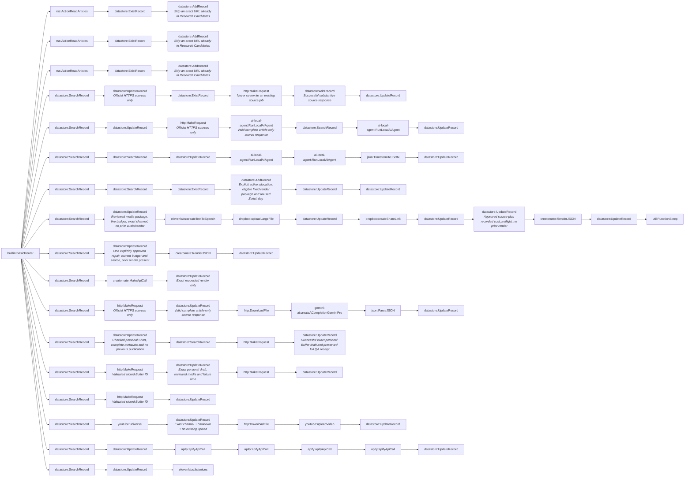

# AI news video pipeline: master scenario (generated)

- Modules: **90** (routers: 1, branches: 17)
- Modules with filters: 21; modules with error handlers: 2

## Apps used

| App | Modules |
|---|---|
| datastore | 56 |
| http | 9 |
| ai-local-agent | 4 |
| apify | 4 |
| rss | 3 |
| creatomate | 3 |
| json | 2 |
| elevenlabs | 2 |
| dropbox | 2 |
| youtube | 2 |
| builtin | 1 |
| util | 1 |
| gemini-ai | 1 |

## Actions

| Action | Count |
|---|---|
| `datastore:UpdateRecord` | 28 |
| `datastore:SearchRecord` | 18 |
| `http:MakeRequest` | 7 |
| `datastore:ExistRecord` | 5 |
| `datastore:AddRecord` | 5 |
| `ai-local-agent:RunLocalAIAgent` | 4 |
| `apify:apifyApiCall` | 4 |
| `rss:ActionReadArticles` | 3 |
| `creatomate:RenderJSON` | 2 |
| `http:DownloadFile` | 2 |
| `builtin:BasicRouter` | 1 |
| `json:TransformToJSON` | 1 |
| `elevenlabs:createTextToSpeech` | 1 |
| `dropbox:uploadLargeFile` | 1 |
| `dropbox:createShareLink` | 1 |
| `util:FunctionSleep` | 1 |
| `creatomate:MakeApiCall` | 1 |
| `gemini-ai:createACompletionGeminiPro` | 1 |
| `json:ParseJSON` | 1 |
| `youtube:universal` | 1 |
| `youtube:uploadVideo` | 1 |
| `elevenlabs:listvoices` | 1 |

## Flow

