# Fact-check pipeline stage 1-research-script-review (generated)

- Modules: **12** (routers: 0, branches: 0)
- Modules with filters: 2; modules with error handlers: 0

## Apps used

| App | Modules |
|---|---|
| datastore | 4 |
| ai-local-agent | 2 |
| json | 2 |
| scenario-service | 2 |
| make-functions | 1 |
| make-ai-web-search | 1 |

## Actions

| Action | Count |
|---|---|
| `datastore:AddRecord` | 2 |
| `ai-local-agent:RunLocalAIAgent` | 2 |
| `scenario-service:CallSubscenario` | 2 |
| `make-functions:DateFunctions` | 1 |
| `datastore:ExistRecord` | 1 |
| `make-ai-web-search:generateAResponse` | 1 |
| `json:CreateJSON` | 1 |
| `datastore:UpdateRecord` | 1 |
| `json:ParseJSON` | 1 |

## Flow

```mermaid
flowchart LR
    m6["make-functions:DateFunctions"]
    m7["datastore:ExistRecord"]
    m6 --> m7
    m8["datastore:AddRecord<br/><i>Only claim missing keys</i>"]
    m7 --> m8
    m12["make-ai-web-search:generateAResponse"]
    m8 --> m12
    m9["ai-local-agent:RunLocalAIAgent"]
    m12 --> m9
    m13["ai-local-agent:RunLocalAIAgent"]
    m9 --> m13
    m15["json:CreateJSON"]
    m13 --> m15
    m10["datastore:UpdateRecord"]
    m15 --> m10
    m20["scenario-service:CallSubscenario<br/><i>Independent text review passed</i>"]
    m10 --> m20
    m21["datastore:AddRecord"]
    m20 --> m21
    m22["json:ParseJSON"]
    m21 --> m22
    m23["scenario-service:CallSubscenario"]
    m22 --> m23
```

