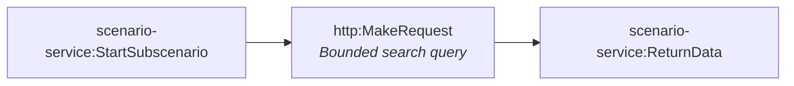

# Fact-check pipeline stage 2b-footage-search (generated)

- Modules: **3** (routers: 0, branches: 0)
- Modules with filters: 1; modules with error handlers: 0

## Apps used

| App | Modules |
|---|---|
| scenario-service | 2 |
| http | 1 |

## Actions

| Action | Count |
|---|---|
| `scenario-service:StartSubscenario` | 1 |
| `http:MakeRequest` | 1 |
| `scenario-service:ReturnData` | 1 |

## Flow

