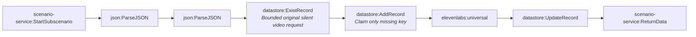

# Fact-check pipeline stage 2c-video-submit (generated)

- Modules: **8** (routers: 0, branches: 0)
- Modules with filters: 2; modules with error handlers: 0

## Apps used

| App | Modules |
|---|---|
| datastore | 3 |
| scenario-service | 2 |
| json | 2 |
| elevenlabs | 1 |

## Actions

| Action | Count |
|---|---|
| `json:ParseJSON` | 2 |
| `scenario-service:StartSubscenario` | 1 |
| `datastore:ExistRecord` | 1 |
| `datastore:AddRecord` | 1 |
| `elevenlabs:universal` | 1 |
| `datastore:UpdateRecord` | 1 |
| `scenario-service:ReturnData` | 1 |

## Flow

