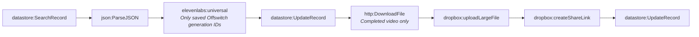

# Fact-check pipeline stage 2d-video-completion (generated)

- Modules: **8** (routers: 0, branches: 0)
- Modules with filters: 2; modules with error handlers: 0

## Apps used

| App | Modules |
|---|---|
| datastore | 3 |
| dropbox | 2 |
| json | 1 |
| elevenlabs | 1 |
| http | 1 |

## Actions

| Action | Count |
|---|---|
| `datastore:UpdateRecord` | 2 |
| `datastore:SearchRecord` | 1 |
| `json:ParseJSON` | 1 |
| `elevenlabs:universal` | 1 |
| `http:DownloadFile` | 1 |
| `dropbox:uploadLargeFile` | 1 |
| `dropbox:createShareLink` | 1 |

## Flow

