# Fact-check pipeline stage 3a-assembly-queue (generated)

- Modules: **18** (routers: 0, branches: 0)
- Modules with filters: 1; modules with error handlers: 0

## Apps used

| App | Modules |
|---|---|
| datastore | 9 |
| json | 7 |
| scenario-service | 2 |

## Actions

| Action | Count |
|---|---|
| `datastore:SearchRecord` | 7 |
| `json:ParseJSON` | 7 |
| `datastore:UpdateRecord` | 2 |
| `scenario-service:CallSubscenario` | 2 |

## Flow

```mermaid
flowchart LR
    m1["datastore:SearchRecord"]
    m2["json:ParseJSON"]
    m1 --> m2
    m3["datastore:SearchRecord"]
    m2 --> m3
    m4["json:ParseJSON"]
    m3 --> m4
    m5["datastore:SearchRecord"]
    m4 --> m5
    m6["json:ParseJSON"]
    m5 --> m6
    m7["datastore:SearchRecord"]
    m6 --> m7
    m8["json:ParseJSON"]
    m7 --> m8
    m9["datastore:SearchRecord"]
    m8 --> m9
    m10["json:ParseJSON"]
    m9 --> m10
    m11["datastore:SearchRecord"]
    m10 --> m11
    m12["json:ParseJSON"]
    m11 --> m12
    m13["datastore:SearchRecord"]
    m12 --> m13
    m14["json:ParseJSON"]
    m13 --> m14
    m15["datastore:UpdateRecord<br/><i>Source-reviewed original production record</i>"]
    m14 --> m15
    m16["scenario-service:CallSubscenario"]
    m15 --> m16
    m17["scenario-service:CallSubscenario"]
    m16 --> m17
    m18["datastore:UpdateRecord"]
    m17 --> m18
```

