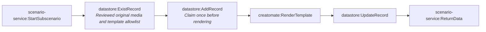

# Fact-check pipeline stage 3b-renderer (generated)

- Modules: **6** (routers: 0, branches: 0)
- Modules with filters: 2; modules with error handlers: 0

## Apps used

| App | Modules |
|---|---|
| datastore | 3 |
| scenario-service | 2 |
| creatomate | 1 |

## Actions

| Action | Count |
|---|---|
| `scenario-service:StartSubscenario` | 1 |
| `datastore:ExistRecord` | 1 |
| `datastore:AddRecord` | 1 |
| `creatomate:RenderTemplate` | 1 |
| `datastore:UpdateRecord` | 1 |
| `scenario-service:ReturnData` | 1 |

## Flow

