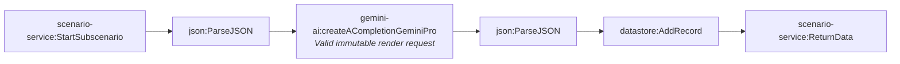

# Fact-check pipeline stage 4a-audiovisual-qa (generated)

- Modules: **6** (routers: 0, branches: 0)
- Modules with filters: 1; modules with error handlers: 0

## Apps used

| App | Modules |
|---|---|
| scenario-service | 2 |
| json | 2 |
| gemini-ai | 1 |
| datastore | 1 |

## Actions

| Action | Count |
|---|---|
| `json:ParseJSON` | 2 |
| `scenario-service:StartSubscenario` | 1 |
| `gemini-ai:createACompletionGeminiPro` | 1 |
| `datastore:AddRecord` | 1 |
| `scenario-service:ReturnData` | 1 |

## Flow

