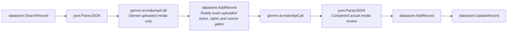

# Fact-check pipeline stage 4b-review-queue (generated)

- Modules: **8** (routers: 0, branches: 0)
- Modules with filters: 3; modules with error handlers: 0

## Apps used

| App | Modules |
|---|---|
| datastore | 4 |
| json | 2 |
| gemini-ai | 2 |

## Actions

| Action | Count |
|---|---|
| `json:ParseJSON` | 2 |
| `gemini-ai:makeApiCall` | 2 |
| `datastore:AddRecord` | 2 |
| `datastore:SearchRecord` | 1 |
| `datastore:UpdateRecord` | 1 |

## Flow

