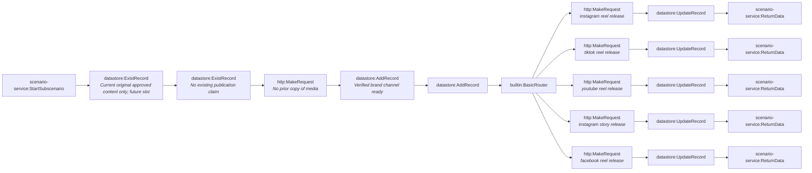

# Fact-check pipeline stage 4c-verified-publisher (generated)

- Modules: **22** (routers: 1, branches: 5)
- Modules with filters: 9; modules with error handlers: 0

## Apps used

| App | Modules |
|---|---|
| datastore | 9 |
| scenario-service | 6 |
| http | 6 |
| builtin | 1 |

## Actions

| Action | Count |
|---|---|
| `http:MakeRequest` | 6 |
| `datastore:UpdateRecord` | 5 |
| `scenario-service:ReturnData` | 5 |
| `datastore:ExistRecord` | 2 |
| `datastore:AddRecord` | 2 |
| `scenario-service:StartSubscenario` | 1 |
| `builtin:BasicRouter` | 1 |

## Flow

