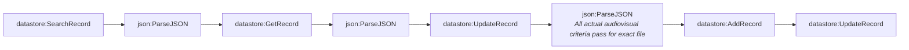

# Fact-check pipeline stage 5a-review-to-release (generated)

- Modules: **8** (routers: 0, branches: 0)
- Modules with filters: 1; modules with error handlers: 0

## Apps used

| App | Modules |
|---|---|
| datastore | 5 |
| json | 3 |

## Actions

| Action | Count |
|---|---|
| `json:ParseJSON` | 3 |
| `datastore:UpdateRecord` | 2 |
| `datastore:SearchRecord` | 1 |
| `datastore:GetRecord` | 1 |
| `datastore:AddRecord` | 1 |

## Flow

