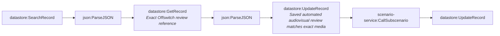

# Fact-check pipeline stage 5b-approved-release-queue (generated)

- Modules: **7** (routers: 0, branches: 0)
- Modules with filters: 2; modules with error handlers: 0

## Apps used

| App | Modules |
|---|---|
| datastore | 4 |
| json | 2 |
| scenario-service | 1 |

## Actions

| Action | Count |
|---|---|
| `json:ParseJSON` | 2 |
| `datastore:UpdateRecord` | 2 |
| `datastore:SearchRecord` | 1 |
| `datastore:GetRecord` | 1 |
| `scenario-service:CallSubscenario` | 1 |

## Flow

