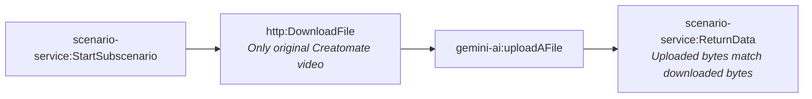

# Fact-check pipeline stage x-media-prepare-review (generated)

- Modules: **4** (routers: 0, branches: 0)
- Modules with filters: 2; modules with error handlers: 0

## Apps used

| App | Modules |
|---|---|
| scenario-service | 2 |
| http | 1 |
| gemini-ai | 1 |

## Actions

| Action | Count |
|---|---|
| `scenario-service:StartSubscenario` | 1 |
| `http:DownloadFile` | 1 |
| `gemini-ai:uploadAFile` | 1 |
| `scenario-service:ReturnData` | 1 |

## Flow

