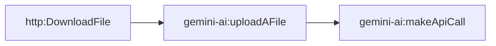

# Fact-check pipeline stage x-narrator-audition (generated)

- Modules: **3** (routers: 0, branches: 0)
- Modules with filters: 0; modules with error handlers: 0

## Apps used

| App | Modules |
|---|---|
| gemini-ai | 2 |
| http | 1 |

## Actions

| Action | Count |
|---|---|
| `http:DownloadFile` | 1 |
| `gemini-ai:uploadAFile` | 1 |
| `gemini-ai:makeApiCall` | 1 |

## Flow

