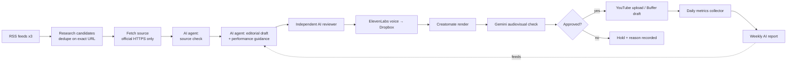

# 1 · AI news-video pipeline (live)

**Problem.** Turn fresh AI-tool news into short explainer videos every day without a human writing, voicing or editing them, and without publishing anything false, duplicated or unreviewed.

**Result.** One Make.com scenario of **90 modules** behind a **17-branch router** runs daily. Each branch is one step of a state machine stored in data stores (research candidates → approved releases → production jobs). See the [generated architecture](../architecture/ai-news-video-pipeline.md).

## Flow (simplified; the full generated diagram is linked above)

## Engineering decisions

- **State machine in data stores, not a spreadsheet.** Every job carries its status (`ready_for_editorial`, `editorial_hold`, `voice_choice_pending`, `public_verified` …), so each daily run picks up exactly where the last one stopped.
- **Claim before work.** A job is marked as claimed before an expensive step (voice, render, upload) starts, so a retry can't double-spend or double-post.
- **Gates as filters.** 21 modules carry filters, for example *"Approved source plus recorded cost preflight; no prior render"*, *"Exact channel + cooldown + no existing upload"*, *"Successful exact Buffer draft and preserved full QA receipt"*.
- **Writer ≠ reviewer.** The drafting agent and the reviewing agent are separate, with separate prompts.
- **Closed feedback loop (added Oct 2026).** A read-only metrics scenario snapshots YouTube statistics daily. A weekly AI report (numbers-only prompt; the deltas are computed in Make, not by the model) is injected into the editorial agent as *lowest-priority* guidance. It may choose between equally supported angles, but it may never invent facts or quote stats. The change added one module; the other branches were verified byte-identical, and a rollback blueprint was kept.
- **Cheap to run.** About 20–25 operations per daily run.
- **Synthetic media is labelled**: uploads set YouTube's `containsSyntheticMedia` flag.

## Measured results (snapshot 11 Oct 2026)

- 11 public videos, 469 total views, 11–188 views per video.
- 0 likes and 0 comments so far. **Engagement is the open problem**, not production.
- What the data says: practical tool features with an access/cost angle (top video: 188 views) beat research news (lowest: 11 views). This finding now goes into the editorial guidance.

## What I'd do next

Re-authorise the YouTube connection with comment scope (the comment-reader scenario is built but blocked by a 403 scope error), add multi-platform publishing behind the same gates, and A/B-test hooks using the weekly report.

*Built with AI coding agents under my specification; I designed the gates, reviewed every change and verified runs in the Make execution logs.*
