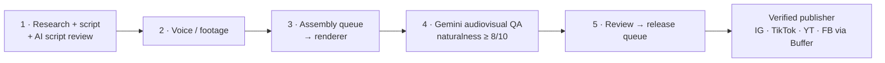

# 2 · Fact-check video pipeline: build + governance audit

**Problem.** Produce short "is this viral clip AI-made?" videos: research a suspected fake, verify it with at least two independent checks, script a verdict, voice and render it, check the result and publish to five platforms.

**What exists.** **14 Make scenarios, 121 modules**, chained as sub-scenarios over one shared job store. Generated diagrams per stage: [architecture/factcheck-pipeline](../architecture/factcheck-pipeline/).

## The audit (Oct 2026)

Before switching this pipeline on, I audited it read-only. These were the key findings:

1. **It had never run end to end.** Every log was a manual test, and the publisher had run once with 0 operations.
2. **Governance gap:** once the AI QA passed, Stage 5 would auto-publish a verdict. Publishing a wrong "FAKE" verdict about real content is the worst failure here, so a human must approve.
3. **Posting-cap bug:** the content-ID pattern allowed 3 items a day, but each item posted both an Instagram reel *and* a story, which meant up to 6 Instagram posts a day.
4. **Content drift:** the prompts still described a previous brand's format, so the AI QA would have judged videos against the wrong criteria.
5. **A real blocker in the logs:** the newest item failed the 8/10 naturalness gate (scored 7/10), and the review queue hit a `400 Unsupported file uri` error that needed a synchronous fallback.

## Fixes applied (each one verified through the API, with a backup taken first)

- Buffer `needsApproval: true` on all 5 publish routes: **a human now approves every post**.
- Instagram restricted to reels only, so the 3-a-day cap now holds.
- QA and review prompts rewritten to the real format: claim and twist in the first 2 s, labelled illustrations, a FAKE label on fake footage, a verdict stamp in the last 5 s, politically neutral, no mocking of private people.
- The research prompt now requires a suspected fake from the last 48 h, at least 2 independent checks, and a verdict.
- All schedules stay **off** until the remaining asset issues (voice, render template) are fixed. Turning on a pipeline that would fail its own QA is wasted spend.

**Why this is in a portfolio.** Building agent pipelines is half the job. The other half is knowing when *not* to switch one on, and leaving a written trail of what was found, changed and still open.

*Built with AI coding agents under my specification; the audit and the fixes were carried out the same way, and each was verified against the Make API.*
